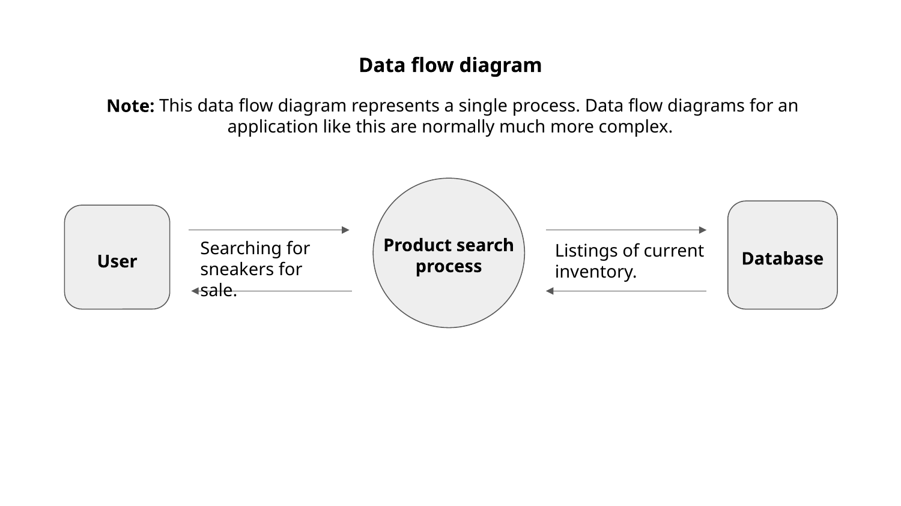
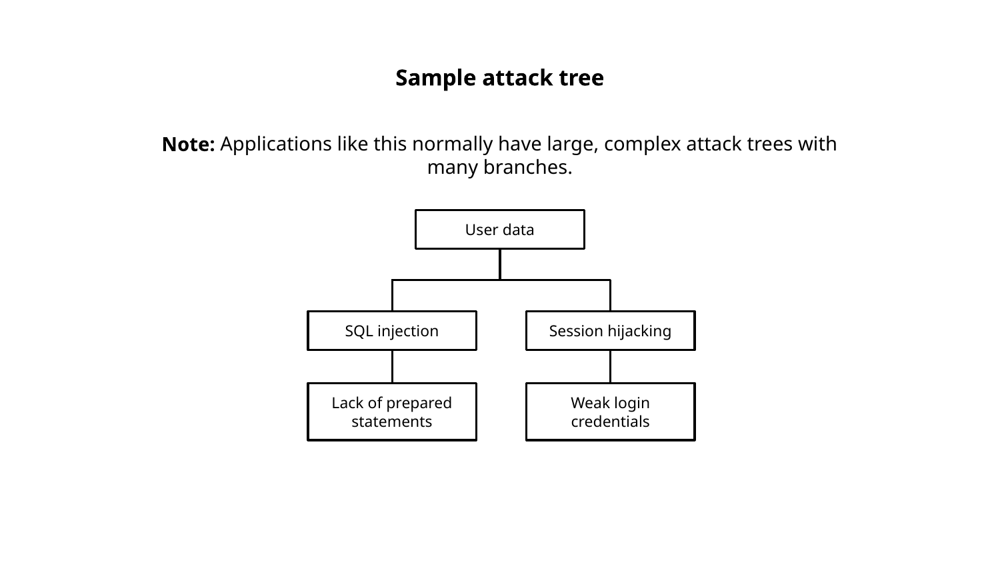

# PASTA Threat Model Report

Sneaker marketplace mobile app scenario
Google Cybersecurity Certificate - Assets, Threats, and Vulnerabilities

## Purpose

This report records my PASTA worksheet answers for a fictional sneaker buy-and-sell app, using PASTA to identify security requirements before launch.

---

## Stage I - Define objectives

**Business objectives identified**

1. Protect users' personal information and maintain their trust.
2. Connect buyers and sellers through an easy-to-use shopping app.
3. Process payments securely and efficiently while meeting legal requirements.

---

## Stage II - Define technical scope

**Course-provided technologies in scope**

- APIs that exchange data between app components
- Encryption (course materials referenced public-key / symmetric approaches such as AES and RSA)
- SHA-256 hashing
- SQL databases

**What I would evaluate first**

I would evaluate the SQL database first because a compromise could expose sensitive user information and disrupt purchases. I would check for SQL injection vulnerabilities, weak access controls, and excessive permissions. These risks make database security a priority, although the APIs and encryption also require review.

**Note on hashing and encryption in the course tech list**

Bare SHA-256 is a general-purpose hash. It is not by itself a complete design for storing passwords (prefer a password-specific, salted construction such as Argon2id or bcrypt) or for encrypting payment card data (that needs proper encryption and payment-handling controls).

---

## Stage III - Application decomposition

I reviewed the **course-provided** data flow diagram. It models a single process, not the full app.

*Course-provided data flow diagram.*

**Labeled elements on the course diagram**

| Element | Role |
|---|---|
| User | External entity |
| Product search process | Process |
| Database | Data store |

**Data flows shown**

- Between User and Product search process: "Searching for sneakers for sale."
- Between Product search process and Database: "Listings of current inventory."

The diagram note states that real applications normally need much more complex data flow diagrams. This sample covers **search only**. It does not show login, messaging, ratings, or payment flows.

**Security takeaway from the sample**

Untrusted search input enters the product search process, and that process exchanges inventory data with the database. Those boundaries are natural places to worry about injection and access control, which later stages address.

---

## Stage IV - Threat analysis

**Two threats I listed for information handled by the app**

1. **SQL injection:** a threat actor manipulates insecure database queries to access, change, or delete data.
2. **Phishing:** fraudulent emails steal users' or employees' credentials and enable account takeover.

---

## Stage V - Vulnerability analysis

**Two vulnerability types I listed**

1. **Unsafe database queries and excessive permissions:** untrusted input inserted into SQL instead of parameterized queries, plus accounts or app roles with more database rights than needed.
2. **Inadequate email filtering and employee phishing awareness:** weak defenses against social-engineering emails that harvest credentials.

These map to the Stage IV threats (injection and phishing).

---

## Stage VI - Attack modeling

I reviewed the **course-provided sample attack tree**. The course notes that real applications normally have large, complex trees with many branches.

*Course-provided sample attack tree.*

**Labels on the course sample**

- Root asset: **User data**
- Left branch: **SQL injection** → **Lack of prepared statements**
- Right branch: **Session hijacking** → **Weak login credentials**

**How this relates to my Stage IV / V analysis**

- The sample's left branch aligns with my SQL injection threat and the unsafe-query / missing prepared-statements style vulnerability.
- The sample's right branch is **not** the same as my phishing analysis. The sample links session hijacking to weak login credentials. In practice weak passwords more directly enable account takeover, while session hijacking involves theft or abuse of an existing session. Phishing is social engineering that steals credentials (often for account takeover). I did not treat the sample's second branch as a rewrite of my phishing findings.

---

## Stage VII - Risk / impact analysis and controls

**Four security controls recommended to reduce the chance of a security incident**

1. **Require multi-factor authentication (MFA) for login**
2. **Use prepared statements with parameterized SQL**
3. **Enforce least privilege for users and application accounts**
4. **Provide phishing awareness training for employees**

These recommendations map to the threats and vulnerabilities above.

---

## Scope and limitations

This was a scenario-based course exercise. Diagrams embedded here are course materials. No live application or implementation was available to validate recommendations or determine launch readiness.

---

## Disclaimer

This report is part of a guided lab from the Google Cybersecurity Professional Certificate (Coursera). The organization and application are fictional training content. The Stage I-VII answers are my completed worksheet analysis.
